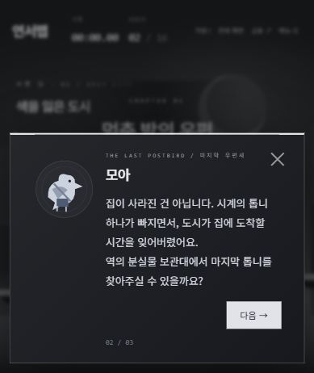

# 연서맵 — 두 세계 사이의 밤

**제작: 박서연 · 컴퓨터공학과**

[공개 게임 플레이](https://seoyeon-map-park.dcoy-40.chatgpt.site)



## 이야기
23:59, 도시의 중앙시계가 톱니 하나를 잃고 멈추자 집으로 향하던 문들의 주소가 사라졌습니다. 2006년생 ISFP 대학생 연서는 마지막 우편새 모아와 귀가할 길을 찾습니다.

회색 도시에서는 모아의 부탁에 따라 역의 분실물 보관대에서 톱니를 찾아 중앙시계를 고치고, 귀가증의 주소와 집의 문을 되찾습니다. 보도블록 아래의 숨겨진 통로는 팔레트 정원으로 이어집니다.

팔레트 정원은 도시와 같은 빛을 나눠 쓰던 세계입니다. 순환이 끊기자 등대의 수집가는 마지막 심장을 지키려 빛을 거두었고, 정원의 주민들이 풍경에 갇혔습니다. 정원사 루미와 세 색의 조각을 모아 악보 퍼즐을 풀고 등대의 공명을 안정시킨 뒤, 마지막 빛을 어떻게 나눌지 선택합니다.

최종 목적지는 연서의 침대입니다. 도시 퀘스트만 완료해도 엔딩에 도달할 수 있고, 정원 퀘스트와 마지막 선택에 따라 3가지 결말과 동행 연출이 달라집니다. 음식 취향·출생 연도·MBTI는 사용자 설정에 기반하며, 인물과 사건은 창작입니다.

## 실제 플레이 요소
- 별도 배치로 구성된 쉬운 맵 / 어려운 맵. 쉬운 맵은 2단 점프를 제공하며 대시 없이도 모든 구간을 건너실 수 있습니다.
- 인물 대화: 모아, 노아, 루미, 등대의 수집가. 짧은 페이지와 보상이 있는 선택지.
- 도시: 귀가증, 시계 톱니, 중앙시계 수리, 집의 문 개방.
- 정원: 파랑·금빛·분홍 조각, 순서 퍼즐, 열린 등대의 문, 점프로 피하는 빛 파동 시련, 마지막 빛의 선택.
- 빛가루 수집, 밤의 상점, 한 번만 열리는 보물상자, 지름길 레버, 편지, 바람 꽃.
- 아이템 가방과 실제 사용 효과: 불닭은 대시 충전, 마라탕은 1회 보호막, 피자는 다음 낙하 구조, 떡볶이는 추가 점프 1회.
- 퀘스트 HUD, 이야기 수첩, 아이템과 퀘스트 물품 확인.
- 체크포인트 자동 저장 및 수동 저장, 저장한 모험 이어하기.
- 난이도별 개인 기록, 실패 횟수, 선택형 효과음과 간단한 배경 화음.
- 모바일 터치 조작, 링크 복사, 전체 화면(지원 브라우저).

## 조작
- 방향키 / A,D: 이동
- Space / 위 방향키 / W: 점프. 길게 누르면 높이 뜁니다.
- Shift / X: 대시. 착지하면 충전됩니다.
- E: 인물 대화, 아이템 획득, 장치 조사, 통로 이동
- I: 가방. 음식을 선택해 사용합니다.
- 아래 방향키 / S: 틈새 통로 앞에서 아래로 내려가기
- Tab: 퀘스트와 이야기 수첩
- R: 현재 세계의 체크포인트로 복귀
- Esc: 메뉴. 저장, 가방, 체크포인트 이동, 난이도 선택 화면 등이 있습니다.

## 저장과 범위
저장은 해당 브라우저의 localStorage를 사용합니다. 다른 기기와 동기화되지 않으며 온라인 순위표는 없습니다. 체크포인트와 아이템·퀘스트를 저장하며, 이어하기는 저장된 체크포인트에서 시작합니다. 진행 중인 등대 시련은 재접속 후 다시 시작합니다. 새 모험은 기존 이어하기 저장을 덮어쓰며, 엔딩 도달 시 이어하기 저장을 지웁니다.

메뉴·가방·대화·이야기 수첩에서는 시간이 멈춥니다. 체크포인트 선택 이동을 사용한 플레이는 개인 최고 기록에서 제외합니다. 음식은 소모성이고, 퀘스트 물품과 열린 상자 등은 실패해도 유지됩니다.

## 로컬 실행
압축을 풀고 index.html을 브라우저로 열면 실행됩니다. 온라인에서 폰트를 불러오며 오프라인에서는 기본 글꼴을 사용합니다.

## 구성
- game.js: 두 난이도의 기본 물리, 맵과 세계 이동
- adventure.js: 퀘스트, 인물 대화, 가방, 아이템, 저장, 퍼즐, 시련, 결말과 추가 장면
- index.html / style.css: 반응형 UI

## 검증
도시 전체 퀘스트, 아이템 소모, 상자 재획득 방지, 보호막·구조 효과, 실제 통로 낙하와 세계 이동, 세 조각과 퍼즐 오답/정답, 공명 시련, 결말 선택, 저장/복구, 침대 성공을 자동 검증했습니다. 네 맵의 발판 사이 도달 가능성과 PC·휴대폰의 대화·가방·시련 화면도 확인했습니다.


## 테스트 실행

Node.js가 설치된 환경에서 다음 명령을 실행합니다. 외부 패키지 설치는 필요하지 않습니다.

```sh
node game.test.cjs
```

게임은 HTML·CSS·JavaScript와 Canvas로 구현되어 있습니다. 저장소의 `index.html`을 브라우저로 열거나, 정적 웹 서버에서 실행하실 수 있습니다.
